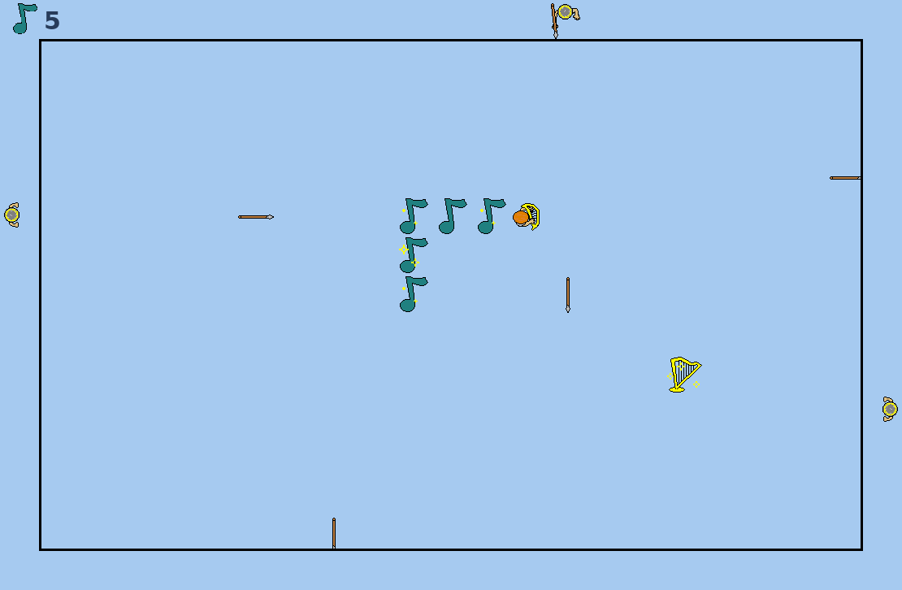

# David Snake — Android

A faithful Android port of *david_snake*, a 2012 C# WinForms game. It looks
like Snake, but David is being ambushed: while he collects golden harps and
trails a line of musical notes behind him, spear-throwers appear along the
walls, take aim just ahead of where he's going, and let fly.

## Get the APK on your phone

1. Create a new **public** GitHub repository.
2. Extract this zip and upload **all of its contents to the repository root** —
   including the `.github` folder. The file `.github/workflows/build.yml` must
   end up at exactly that path, or the build won't trigger.
3. Commit. GitHub Actions builds the app automatically (2–4 minutes — watch
   the **Actions** tab).
4. Open **Releases** → **David Snake — latest build** → download
   **david-snake.apk** on your phone and open it. Android will ask you to
   allow installs from your browser ("install unknown apps") the first time.

Every later commit rebuilds the APK and refreshes the same `latest` release.
The debug signing key is committed with the project, so new builds install
straight over the old one — no uninstalling.

## How to play

Swipe anywhere to steer. A swipe is read relative to the way David is
going: any clearly sideways move turns him that way, and a turn moves him
a step right away. Fast flicks count after a few dp, slow drags need a
little more, and a quick flick counts even when the finger lifts at once.
Keep dragging and bend sharply to make the next turn, so you can carve
zigzags in one continuous drag. Swiping straight back the way he came
makes a U-turn (a step to the side, then, on his next regular step,
back). Tap to start, and to retry after a loss. The build number is in
the top-right corner.
Collect harps to grow your trail of notes. Spears kill only on a head hit;
they pass over your tail and stick into the far wall (six at most — the
oldest falls out). When you're pressed against a wall you get a beat to
swipe away before it's over. Attackers always throw from the wall on your far side, aiming one
cell ahead of you. Waves come faster and larger the longer you survive.

And yes — after you fall, they keep throwing. The original did that too.

## Input test (debug mode)

Debug mode is on when the app starts (for now): games are recorded, with
the normal input (`MNL1`). Dragging along the very top
edge of the screen from one side to the other turns it off, and on again. The top-right corner shows how many games are stored.

- Every recorded game is saved as it ends, in the app's own storage, and
  kept across app restarts and debug mode on/off. *Export games* (start
  and lose screens, in debug mode) joins all stored games into one file,
  `Downloads/DavidSnake_Games_v<version>_<date>_<time>_<N>games.txt`,
  reads it back to check it is complete, and only then clears them.
  Analyze with `python3 tools/lab_report.py FILE`; score input methods
  with `python3 tools/windowsim.py FILE...`: at every game tick in which
  the finger moves (1 dp or more within the tick; a resting finger, or
  none, starts nothing; until v1.18 only at detected gestures, so the
  scores quoted for the models up to MNL1 are per 1000 of those
  gestures and not comparable with the per-tick windows), each method
  reads the first 250 ms of finger input from the real situation (if it
  turned David, one more turn may come before his next regular step: the
  second half of a one-cell side step or U-turn), an exact port of the
  engine (`tools/enginesim.py`, checked by replaying every recorded
  game) plays its turns, and David goes on straight until he dies: the
  harp on the way counts +1 (whenever it comes), a death before it -0.5
  times exp(-(s-1)/d) (s steps after the gesture start; d = 1 step for a
  wall or the tail, 3.7 for a spear). A run in which he is speared from
  the side, or speared after eating the harp, has no score and is left
  out of every average (the tables say how many): the recorded spears
  were aimed at the path he took in the real game, not this one. The
  same if he enters the phantom tail, the cell one behind the tail's
  end, moving as if the tail were one cell longer. Reading only 250 ms
  keeps out what the player did in
  reaction to the live model's turns. Needs v1.7+ recordings (every
  spear throw logged); model choices and training use only those, older
  ones are for sanity checks.
  `python3 tools/intentlearn.py FILE... --holdout 0.3 --seed 1 --never-test FILE,...`
  trains a small weighted-formula turn model (finger movement only) to
  make the turn the player meant as early as the finger shows it: the
  live game's turns give each gesture's intended direction, the answer
  at a tick is the first intended turn not yet made, from the moment the
  gesture detector counts the movement (DAgger on the live games and the
  model's own play of the windows; `--w-turn`, `--w-reject`, `--w-hold`
  weigh turns, movements the live game ignored, and the time right after
  a turn; `--model mlp --hidden H` trains the non-linear MNL model instead:
  one hidden layer of H units, no `back` answer, so a U-turn is two side
  turns, and no finger-speed input, 17 inputs and 19 H weights). It holds out a seeded 30% of the games (never from the
  `--never-test` files) or cross-validates (`--folds 4`), and reports the
  window score next to latency, wrong, missed, spurious and early turns,
  also broken down by the recognizer the games were played with; `--export`
  prints just the weights. The window score only judges: it is calibrated
  to the live recognizer's latency (a turn one tick earlier or later than
  it loses about 3% of harps either way), so `tools/simlearn.py`, which
  learns from the score (learning to search), only copies the live
  recognizer plus noise; it is kept for reference.
  `python3 tools/compare_models.py FILE... --models tools/models/ml-1.json,...`
  (same split options) prints the training, test and summary score tables,
  and `tools/export_model.py` records a model with a complete description
  (`tools/models/<name>.json`; `--trainer intent` for intentlearn), and
  with `--game` puts it in the game (`MlModel.kt`). `--tolerance 1
  --ref ML-1` in `compare_models.py` prints the accuracy score tables and
  differences against ML-1.
- The input is `MNL1` (from v1.18; `tools/models/mnl1.json`), the
  non-linear model: one hidden layer of 16 units (304 weights) over 17
  inputs of finger movement (no finger speed) with no `back` answer, so a
  U-turn is two side turns. Trained with `tools/intentlearn.py --model mlp`
  on 123 of the 176 recorded games (53 held out, all played with ML-1 and
  new to it too): on the held-out games it is the first model to beat
  ML-1 on the final score below with 4 ticks of tolerance (496.9 vs
  487.9 per 1000 gestures, +9.0, 90% range +3.2 to +16.0; plain window
  score 359.4 vs 354.4), turning sooner (0.59 vs 0.83 ticks after the
  gesture start; turns 2 ticks or later 63 vs 130 per 1000) and making
  more turns than the live game made (43 per 1000 where the live game
  made none; fed whole live games, 5.0 turn starts per minute where the
  live game made none, against ML-1's 2.5). On the per-tick windows (every
  game tick with finger movement) the picture is the same: final score
  379.2 vs ML-1's 368.3 per 1000 windows (+10.9, 90% range +6.0 to +17.0;
  plain 304.4 vs 298.9), with more turns the live game did not make (fed
  whole live games, 2.8 turn starts per minute against 0.1 on ML-1's own
  games, 2.7 against 1.7 on S2-FAST's). `MNL2-a` and `MNL2-b`
  (`tools/models/`), MNL1's training rerun on the per-tick windows (b
  weighting small movements the live game ignored, `--reject-small`),
  score the same (+9.1, +10.0) with fewer such turns (1.9 per minute),
  still make the recorded lift-off turn that killed MNL1, and are not in
  the game. `MNS1` (`tools/models/mns1.json`) was trained on the score
  alone (`tools/scorelearn.py`, `docs/score_training.md`: at every
  moving-finger tick the best of none, right and left by simulation, with
  the final score's lags) and scores far below (149.1 vs 304.4 plain,
  309.8 vs 379.2 final): at two thirds of the decision points a turn
  toward the harp's row or column beats going straight whatever the
  finger did, which a finger-only model cannot tell apart. `MNW1`
  (`tools/models/mnw1.json`) was trained on the window score itself
  (`tools/windowtable.py`, `tools/windowlearn.py`, `docs/window_training.md`:
  every course of action in every window scored once, then the softmax
  model's expected final score climbed exactly, from random weights, no
  labels) and is the first model trained on a score to beat MNL1: final
  score 385.5 vs 379.2 on the held-out games (+6.3, 90% range +1.2 to
  +10.9; plain 308.4 vs 304.4); it still makes the recorded lift-off turn.
  Before it: `ML-3` (v1.17),
  the linear model trained the same way, which turns about a quarter
  sooner than ML-1 (0.63 ticks; late turns 82 per 1000) with the same
  window score (355.3) and the same final score (411.4 vs 414.7 with 1
  tick of tolerance, 90% range -10.4 to +4.0); `ML-4`
  (`tools/models/ml-4.json`), the same training weighted for fewer turns
  the live game did not make (24 vs 44 per 1000): final score 415.2,
  latency 0.71 ticks; `ML-2` (v1.16,
  trained on the window score: slower, missing more swipes, and less
  accurate: final score 410.0, -4.6 against ML-1, -8.2 to -1.4) and
  `ML-1` (41 games). Every recorded game starts
  with a `model` line holding the input in full: recognizer, settings,
  weights, features, and how it was trained (code commit, training files
  with sha256, settings, held-out games), so it can be rebuilt from the
  file alone; every finger sample carries its game tick.
  `python3 tools/mlparity.py FILE` rebuilds the model from each game's
  model line, replays the game, and checks every decision.
- Final score (timing-tolerant): `tools/compare_models.py --tolerance 1`
  (and the `final` column of `tools/intentlearn.py`) scores each window by
  0.9 times the best score of the model's turns moved together one tick
  before, not at all, or one tick after where it made them, plus 0.1
  times the plain run (`--alpha` sets the mix; a turn placed one tick
  before the window runs from the real state one tick earlier), so timing
  counts for little and the score shows the accuracy of the turns
  (direction, unwanted and missed turns). `--anchored` places every
  model's turns one tick before to one tick after the live game's turn
  instead, the same placements for all, which removes timing entirely.
  The paired noise over games is about a third of the plain score's. The
  plain score mixes timing in: the player timed every swipe for the
  recognizer that was playing, so a turn one tick earlier or later than
  it loses about 3% of harps either way (measured on ML-1: -30 and -27
  per 1000), and `tools/simlearn.py`, which learns from the plain score
  (learning to search), only copies the live recognizer plus noise
  (ML-2); regret training on the final score (`--tolerance 1 --init
  MODEL`) keeps a model's accuracy but loses its speed.
- `viewer/decisions.html` (open it in a browser) replays example gestures
  from the recordings as the game screen, once per input method (S2-FAST,
  ML-1, ML-3), next to the finger movement, with how often the methods
  decide differently; `python3 tools/make_viewer.py` rebuilds it.
- `viewer/finishing_rules.html` (open it in a browser) compares two ways
  of finishing a move after 250 ms of reading (one more turn until 300 ms,
  or before David's next regular step) on recorded side steps and U-turns
  where they disagree; `python3 tools/make_rules_viewer.py` rebuilds it.
- `training_recordings/` holds the recordings for scoring and training,
  as the app exported them, with a list of what is in it (its README).
  Add new exports with `python3 tools/add_recordings.py FILE...`, which
  skips duplicate files and games and checks every game replays exactly.
  The models' descriptions name the files they were trained on, with
  hashes.

Earlier tests: test 1 (v1.1.50) found the original input best for long
continuous drags and beat-timed movement worst; the original's only
flagged failures were blocked backward swipes, now U-turns. Test 2
(`O-HOLD-UTURN`, `O-HOLD-ALL`, `O-PLUS-28`, `S2-STEP`) and a replay of
all recordings against intents inferred from the game
(`tools/intent.py`; a trained classifier, `tools/classifier.py`, did not
beat the hand-built readers) led to test 3: `S2-FAST` (S2 with a 0.12 s
blind spot after a turn) scored best in replay but `O-HOLD-UTURN` did
better in play.

## Project notes

Plain Kotlin with zero dependencies: one Activity, a custom Canvas view,
and all UI built in code (no layout XML). The game logic lives in
`GameEngine.kt`, a line-faithful port of the original's `Form1.cs`,
`figure.cs`, `attaker.cs` and `math.cs`, preserving its tick structure
(the snake steps every 4th tick and spears move every tick; a turn
executes either as the original's immediate step or in a metronome mode
with one instant rotation per movement plus one queued turn, see
`TurnMode`) at a relaxed
mobile pace, locked to the original's hard difficulty, and its quirks —
including the difficulty-scaled wall-grace window and the post-death spear
rain. One genuine bug in the original was fixed (the harp could briefly
respawn under the first tail segment) and is flagged with a comment. The
sprites are the original 48-pixel bitmaps, converted to transparent PNGs
and drawn with nearest-neighbor scaling so they stay crisp. The engine was
validated headlessly with ~600k simulated ticks (1.8M assertions) across
all difficulties — the simulator is in `tools/sim/Sim.kt`.

There is intentionally no Gradle wrapper: the workflow installs Gradle 8.7
on JDK 17 (AGP 8.5.2, compileSdk 34, minSdk 26). To build locally instead,
install Gradle 8.7 and the Android SDK, then run `gradle assembleDebug`.

Original game and artwork by the original author, 2012. This port keeps
both intact.
